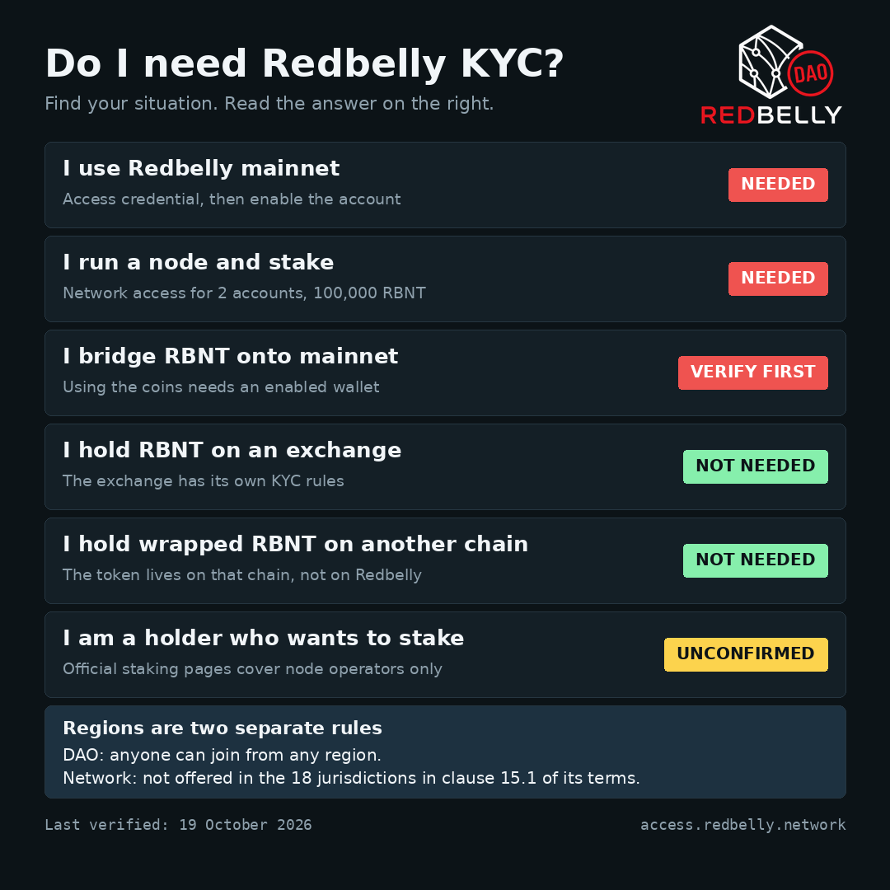

# KYC and Wallet Activation Explainer

A plain language guide to Redbelly KYC and wallet activation, written for the Redbelly DAO community. It answers the questions moderators get asked again and again, in one place, so people can link a single page.

Last verified: 19 October 2026.

## Quick answer

| Your situation | Redbelly KYC |
| --- | --- |
| I use Redbelly mainnet | Needed |
| I run a node and stake | Needed |
| I bridge RBNT onto mainnet | Verify first, you need an enabled wallet to use the coins |
| I hold RBNT on an exchange | Not needed |
| I hold wrapped RBNT on another chain | Not needed |
| I am a holder who wants to stake | Unconfirmed, no official page says |

Two regional rules exist and they are not the same thing:
- **The DAO:** anyone can join from any region.
- **The network:** Redbelly does not offer its services in the 18 jurisdictions listed in clause 15.1 of its [terms and conditions](https://redbelly.network/terms-and-conditions).

## Who this is for

- A new RBNT holder who is not sure whether they need KYC.
- Someone holding wrapped RBNT on another chain.
- Someone from a region the DAO used to exclude.
- Someone whose verification is slow, rejected, or out of wallet slots.

## What is inside

| File | What it is |
| --- | --- |
| `index.html` | The full guide as a web page, Parts A to D |
| `GUIDE.md` | The same guide as Markdown |
| `img/decision-guide.png` | The Part A decision guide. `img/decision-guide.svg` is the vector version |
| `pin.txt` | The short version to pin in Discord or Telegram, posted with the image |
| `SOURCES.md` | Every source, marked official or community reported |

The guide has four parts:
1. **Part A:** do I need KYC, as a table you can read in seconds.
2. **Part B:** the five common questions, each with a one line answer first.
3. **Part C:** getting verified and activating a wallet, step by step, including how to add another wallet.
4. **Part D:** when something goes wrong, including how to open an Averer support ticket.

## How to read the answers

- **Needed:** an official source says so.
- **Not needed:** no official page says it in those words, but it follows directly from an official rule. The rule is named in the guide.
- **Unconfirmed:** no official page settles it. The reason is given.

Every fact carries a source number such as `[S13]`. Facts from community posts are labelled community reported and unconfirmed.

## Known gaps

These are marked as unconfirmed in the guide until an official page covers them:
- The exact wallet limit per verified identity. The guide uses about 10, as stated in the DAO task brief.
- A published approval time.
- Any rule for ordinary holders who want to stake.

## Safety

Use only the official portal at https://access.redbelly.network/. Never share your seed phrase or private key with anyone, including in a support ticket.

## Keeping it current

Redbelly and Averer change their process over time. If a step or a source no longer matches the live official page, open an issue or a pull request with the new official link.
